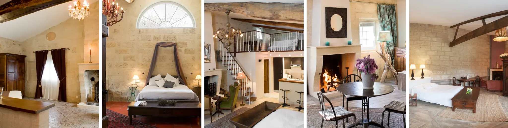

<p align="center">
  
</p>

<h1 align="center">Château Latour Ségur</h1>

<p align="center">
  <em>Chambres d'hôtes & spa près de Saint-Émilion</em>
</p>

<p align="center">
  <a href="https://www.chambredhotesaintemilion.fr"><b>chambredhotesaintemilion.fr</b></a>
  &nbsp;·&nbsp;
  <a href="https://www.chambredhotesaintemilion.fr/en">English</a>
</p>

<p align="center">
  <a href="https://www.chambredhotesaintemilion.fr"></a>
  
  
  
  
  <br>
  
  
  
  
</p>

<br>

## Les suites

<p align="center">
  
</p>

| Suite | Esprit | Pers. | Nuit | Min. |
| --- | --- | :-: | --: | :-: |
| **Terre** | Pierre, bois et bain à remous | 3 | 240 € | 2 nuits |
| **Feu** | Lit à baldaquin, au coin du feu | 2 | 240 € | 2 nuits |
| **Métal** | La plus spacieuse, en mezzanine | 4 | 395 € | 2 nuits |
| **Eau** | Un univers de douceur, à deux | 2 | 195 € | 1 nuit |
| **Bois** | Cottage indépendant, côté jardin | 2 | 195 € | 2 nuits |

Petit-déjeuner en option à 18 € par personne et par nuit. Taxe de séjour : 1,14 € par personne et par nuit. Tous les tarifs vivent dans [`src/lib/pricing.ts`](src/lib/pricing.ts), partagé entre le site et le serveur.

## Ce que fait le site

- **Site vitrine bilingue** : français sur `/`, anglais sur `/en`, pré-rendu en HTML statique pour le référencement.
- **Fiche par suite** avec galerie photo et calendrier des disponibilités en direct.
- **Réservation en ligne** payée en totalité avec Stripe Checkout, avec petit-déjeuner en option et rappel pour le spa.
- **« Gérer ma réservation »** : le client annule (remboursement automatique) ou modifie ses dates pendant 24 h après le paiement.
- **Synchronisation Beds24** : les dates prises sur Airbnb, Booking… se ferment sur le site chaque nuit, et les réservations payées sur le site remontent dans Beds24.
- **E-mails Resend** : alerte au château pour chaque réservation ou demande, confirmation au client.
- **Formulaire de demande** pour les séminaires, événements et le spa.

<p align="center">
  
</p>

## Démarrer

```bash
npm ci
npm run dev                # http://localhost:5173
```

| Commande | Rôle |
| --- | --- |
| `npm run dev` | serveur de développement |
| `npm run lint` | ESLint |
| `npm run build` | `tsc` puis pré-rendu de toutes les pages dans `dist/` |
| `node scripts/verify.mjs` | contrôle de bout en bout sur `dist/` (Playwright + axe) |
| `DATABASE_URL=postgres://… npm run test:booking` | réservation payante de bout en bout (PostgreSQL local + faux Stripe) |

## Architecture

```
src/
├── pages/            fiches suites, retour de paiement, gérer ma réservation, mentions légales
├── components/       calendrier, formulaire de réservation, galerie des suites…
├── lib/              contenus FR/EN (content.ts, ui.ts), tarifs (pricing.ts)
└── assets/suites/    photos des suites, une par dossier (voir son README)
api/                  fonctions serverless Vercel
supabase/schema.sql   schéma, RLS et fonctions (ré-exécutable dans le SQL Editor)
scripts/              tests de bout en bout et audits (mobile, SEO)
```

| Point d'API | Rôle |
| --- | --- |
| `api/availability.ts` | `GET` périodes indisponibles (vue Supabase `availability`) |
| `api/booking-request.ts` | `POST` demande du formulaire → `booking_requests` |
| `api/checkout.ts` | `GET` paiement en ligne actif ? `POST` bloque les dates (`pending`) et crée la session Stripe |
| `api/stripe-webhook.ts` | confirme les paiements (`paid`), libère les dates expirées ou remboursées |
| `api/booking-status.ts` | pages de retour de Stripe : état du paiement, abandon |
| `api/manage-booking.ts` | annulation et modification par le client, 24 h après le paiement |
| `api/sync-beds24.ts` | Beds24 → `availability_blocks`, tâche planifiée chaque nuit à 4 h (UTC) |

Le navigateur ne détient aucune clé Supabase : toutes les lectures et écritures passent par `api/*` avec la clé `service_role`.

## Variables d'environnement

À renseigner dans Vercel → Settings → Environment Variables (modèle dans [`.env.example`](.env.example)).

| Variable | Usage |
| --- | --- |
| `SUPABASE_URL`, `SUPABASE_SERVICE_ROLE_KEY` | base de données |
| `STRIPE_SECRET_KEY`, `STRIPE_WEBHOOK_SECRET` | paiement en ligne (sans elles, le site garde le formulaire de demande) |
| `ONLINE_BOOKING=off` | coupe le paiement sans retirer les clés |
| `BEDS24_TOKEN`, `BEDS24_REFRESH_TOKEN` | lecture des disponibilités, écriture des réservations payées |
| `CRON_SECRET` | protège la synchronisation Beds24 appelée en webhook |
| `RESEND_API_KEY`, `OWNER_EMAIL` | e-mails et adresse qui reçoit les alertes |
| `EMAIL_FROM`, `EMAIL_REPLY_TO` | expéditeur vérifié (confirmation client) et adresse de réponse |
| `VITE_RYBBIT_SITE_ID` | statistiques, valeur publique par défaut dans `.env.production` |

<details>
<summary><b>Mettre en place la réservation Stripe</b></summary>

1. Exécuter `supabase/schema.sql` dans le SQL Editor de Supabase.
2. Dans Stripe (mode test d'abord) : Développeurs → Webhooks → ajouter `https://www.chambredhotesaintemilion.fr/api/stripe-webhook` avec les événements `checkout.session.completed`, `checkout.session.expired`, `charge.refunded`.
3. Renseigner `STRIPE_SECRET_KEY` et `STRIPE_WEBHOOK_SECRET` dans Vercel, puis redéployer.
4. Activer les reçus par e-mail dans Stripe (Paramètres → E-mails clients → Paiements réussis).

Statuts dans la table `bookings` : `paid` (confirmée), `conflict` (payée mais dates prises entre-temps, à rembourser), `expired` / `cancelled` (abandon), `refunded`.
Carte de test : `4242 4242 4242 4242`, date future, CVC quelconque.

</details>

<details>
<summary><b>Brancher Beds24 en écriture</b></summary>

Pour que les réservations payées apparaissent dans Beds24 et ferment les dates sur Airbnb, Booking… : dans Beds24, Paramètres → Marketplace → API, créer un code d'invitation avec les droits de lecture et d'écriture des réservations (pas « long life token », qui ne permet que la lecture). L'échanger contre un refresh token :

```bash
curl -H "code: <code>" https://api.beds24.com/v2/authentication/setup
```

Mettre le `refreshToken` obtenu dans `BEDS24_REFRESH_TOKEN`. Il expire après 30 jours sans usage ; la tâche quotidienne `api/sync-beds24` s'en sert chaque jour.

</details>

<details>
<summary><b>Configurer les e-mails Resend</b></summary>

1. Créer un compte Resend avec l'adresse qui reçoit les alertes, puis une clé API « Sending access ». Mettre `RESEND_API_KEY` et `OWNER_EMAIL` dans Vercel. Les alertes partent alors de `onboarding@resend.dev`, qui ne peut écrire qu'à l'adresse du compte.
2. Dans Resend → Domains, ajouter `mail.chambredhotesaintemilion.fr` (région Irlande, eu-west-1) et faire ajouter ses enregistrements DNS chez Infomaniak, avec un `_dmarc` s'il n'y en a pas.
3. Une fois le domaine vérifié, mettre `EMAIL_FROM="Château Latour Ségur <reservations@mail.chambredhotesaintemilion.fr>"` dans Vercel et redéployer : la confirmation au client part aussi. Les réponses vont à `contact@chateaulatoursegur.com` (`EMAIL_REPLY_TO` pour changer).

Un e-mail qui échoue ne bloque jamais une réservation ; l'erreur apparaît dans les journaux Vercel (`email …`).

</details>

<br>

<p align="center">
  <sub>Château Latour Ségur · Saint-Émilion, Gironde</sub>
</p>
